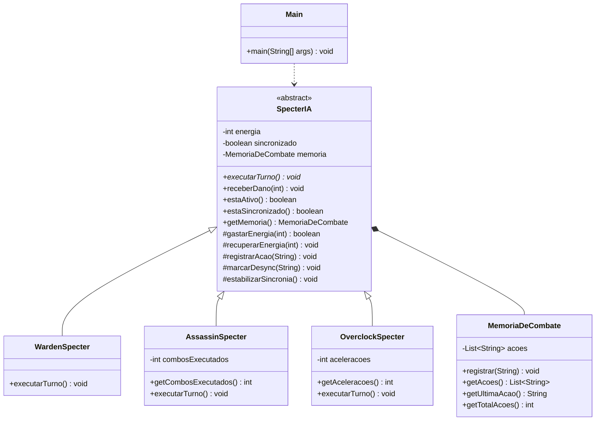

# Specter League

Núcleo orientado a objetos, em Java, dos **Specters** da Specter League: inteligências artificiais treinadas com o estilo de cada jogador que disputam as partidas no lugar dele.

## Contexto

Na Specter League, o jogador não segura o controle. Ele treina um Specter com a sua assinatura de jogo, e o Specter compete por ele, inclusive nas partidas transmitidas de madrugada para milhões de espectadores.

A base de código original concentrava o comportamento de todas as classes em um único `switch`. Cada correção emergencial quebrava a anterior, e esse acúmulo levou a falhas de sincronização (`DESYNC`) em plena transmissão.

Este projeto substitui esse modelo por uma arquitetura orientada a objetos, em que:

- cada classe de Specter define o próprio comportamento de turno, sem `switch` central;
- o **corpo** do Specter (energia, estado de sincronia) é separado do seu **histórico** (`MemoriaDeCombate`);
- novos tipos de Specter podem ser adicionados sem alterar o código existente.

## Classes de Specter

| Classe | Estilo de jogo |
|---|---|
| `WardenSpecter` | Controla o ritmo e segura a linha. |
| `AssassinSpecter` | Some, volta e explode o combo. Registra os combos executados. |
| `OverclockSpecter` | Arrisca tudo pela velocidade. Registra as acelerações realizadas. |

## Arquitetura



### Componentes

**`SpecterIA`** é a classe abstrata base. Ela mantém o estado comum a todo Specter (`energia`, `sincronizado` e a `memoria`) e expõe as operações compartilhadas:

- `receberDano`, `estaAtivo` e `estaSincronizado` para consultar e alterar o estado;
- `gastarEnergia` e `recuperarEnergia` (protegidos) para o controle do recurso de energia;
- `registrarAcao` (protegido), que grava a ação na memória de combate;
- `marcarDesync` e `estabilizarSincronia` (protegidos) para controlar o estado de sincronização;
- `executarTurno()`, abstrato, que cada subclasse implementa com a sua própria lógica.

**`MemoriaDeCombate`** guarda o histórico de ações do Specter. Ela é uma classe independente, associada ao Specter por **composição**: cada Specter tem a sua memória, criada junto com ele. Oferece `registrar`, `getAcoes`, `getUltimaAcao` e `getTotalAcoes`.

**`WardenSpecter`, `AssassinSpecter` e `OverclockSpecter`** estendem `SpecterIA` e implementam `executarTurno()` de acordo com o seu estilo de jogo. O `AssassinSpecter` e o `OverclockSpecter` mantêm ainda um contador próprio (`combosExecutados` e `aceleracoes`).

**`Main`** é o ponto de entrada. Ele trabalha com uma lista de `SpecterIA` e chama `executarTurno()` em cada item, sem conhecer a classe concreta de cada um.

## Princípios de design

- **Abstração:** `SpecterIA` define o contrato comum e deixa o comportamento de turno para as subclasses.
- **Herança:** as três classes de Specter reaproveitam estado e operações da base.
- **Polimorfismo:** `executarTurno()` se comporta de forma diferente em cada classe, e quem o chama usa apenas o tipo `SpecterIA`.
- **Encapsulamento:** os atributos são privados e o estado só muda por métodos que protegem as regras (por exemplo, `gastarEnergia` retorna `boolean` ao validar a energia disponível).
- **Composição:** o histórico vive em `MemoriaDeCombate`, separado do corpo do Specter.

## Como executar

**Requisitos:** JDK 17 ou superior.

```bash
git clone https://github.com/<usuario>/<repositorio>.git
cd <repositorio>

javac -d out $(find . -name "*.java")
java -cp out Main
```

No Windows (PowerShell):

```powershell
javac -d out (Get-ChildItem -Recurse -Filter *.java).FullName
java -cp out Main
```

## Adicionando um novo tipo de Specter

1. Crie uma classe que estenda `SpecterIA`.
2. Implemente `executarTurno()` com o comportamento da nova classe, usando `gastarEnergia`, `recuperarEnergia` e `registrarAcao` conforme necessário.
3. Inclua uma instância na lista do `Main`. Nenhuma outra classe precisa ser alterada.
