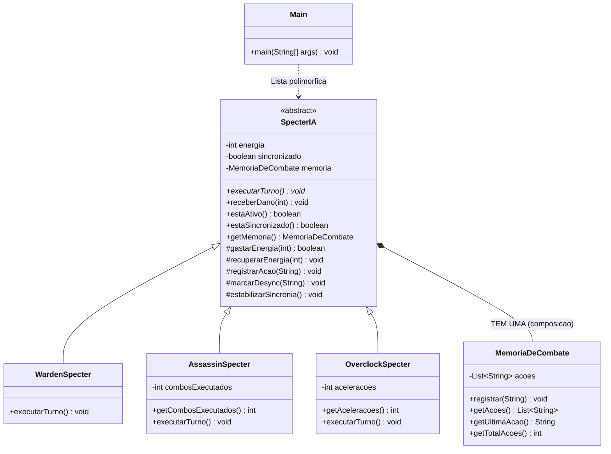

# Specter League — Night Patch Cell (Grupo Sigma)

Night Patch Cell convocada pela SP Tech para substituir o switch monstro da AfterDark Interactive por um núcleo OOP antes do re-run do Night Cap (23h59).

**Repo:** https://github.com/isaacazevedopinheiro/grupoSigma

## Papéis XP

> Atribuição por responsabilidade de entrega; substitua "Integrante" pelos nomes da squad antes de apresentar.

| Papel XP | Responsabilidade | Artefato |
| --- | --- | --- |
| Arquiteto de Domínio | Decidir a abstração e proteger estado | `SpecterIA`, `MemoriaDeCombate` |
| Dev de Combate | Herança e comportamentos `@Override` | `WardenSpecter`, `AssassinSpecter`, `OverclockSpecter` |
| Integrador / QA | Polimorfismo no chamador e validação | `Main`, compilação e execução |
| Prompt Engineer / Documentador | IA responsável, diagrama e README | `docs/diagrama-classes.mmd`, este README |

## O que modelamos

Modelamos o specter como **corpo + histórico separados**: `SpecterIA` guarda energia, a flag de `sincronizado` e **tem uma** `MemoriaDeCombate` (composição, não herança). `Warden`, `Assassin` e `Overclock` herdam o contrato `executarTurno()` e cada um gasta/recupera energia com uma assinatura diferente. No `Main`, uma `List<SpecterIA>` recebe a **mesma** chamada `executarTurno()` e cada objeto concreto responde do seu jeito — é o polimorfismo que evita o switch da madrugada. O `DESYNC` virou estado protegido por métodos (`receberDano`, `gastarEnergia`, `marcarDesync`), não um `if` solto no overlay.

**Decisão de abstração (fala de 15s):** escolhemos **classe abstrata** em vez de interface porque os três specters compartilham estado (energia, sync, memória) e regras de dano; só o turno muda. O `abstract executarTurno()` é o gancho que obriga cada subclasse a ter comportamento próprio.

## Diagrama de classes

Arquivo-fonte: [`docs/diagrama-classes.mmd`](docs/diagrama-classes.mmd) (cole no [Mermaid Live](https://mermaid.live/) ou renderize no GitHub).



## Onde está cada conceito

| Conceito | Evidência no código |
| --- | --- |
| Abstração | `public abstract class SpecterIA` + `public abstract void executarTurno()` |
| Encapsulamento | `private int energia`, `private boolean sincronizado`, `private final MemoriaDeCombate memoria`; invariantes em `receberDano()` / `gastarEnergia()` / `marcarDesync()`; `getAcoes()` devolve lista não modificável |
| Herança | `WardenSpecter`, `AssassinSpecter` e `OverclockSpecter extends SpecterIA` |
| Polimorfismo | `for (SpecterIA specter : squad) specter.executarTurno();` em `Main.java` — chamada no tipo base, execução na subclasse |
| Composição | `SpecterIA` **tem uma** `MemoriaDeCombate` e delega nela via `registrarAcao()`; `Main` cria uma memória nova por specter |

## Como executar

Com JDK 21 (o Maven do IntelliJ também funciona com `mvn compile`):

```powershell
New-Item -ItemType Directory -Force target\classes
javac -encoding UTF-8 -d target\classes src\main\java\com\sptech\specterleague\*.java
java -Dfile.encoding=UTF-8 -cp target\classes com.sptech.specterleague.Main
```

Saída esperada: 3 turnos; Warden termina ativo e sincronizado, Assassin e Overclock entram em `DESYNC` ao ficar sem energia.

## IA generativa: uso responsável

**Prompt usado (Copilot/ChatGPT):**

> "Em Java 21, gere apenas o esqueleto do núcleo OOP da Specter League: uma classe abstrata SpecterIA com energia privada, flag de sincronia e uma MemoriaDeCombate por composição, o método abstrato executarTurno(), três subclasses (Warden, Assassin, Overclock) e um Main com List<SpecterIA> demonstrando polimorfismo. Não crie um jogo completo, não use switch por classe e explique onde fica cada conceito."

**Ajuste feito pelo grupo:** a IA sugeriu inicialmente `SpecterIA extends MemoriaDeCombate`. Corrigimos para **composição** (`private final MemoriaDeCombate memoria` + `Objects.requireNonNull`), porque memória é histórico que o specter *tem*, não um tipo que ele *é*. Também centralizamos a escrita na memória via `registrarAcao()` e transformamos o `DESYNC` em estado protegido. Revisamos cada `System.out` antes de commitar — nenhum segredo ou token foi incluído.

## Checklist da apresentação

- [x] Diagrama Mermaid legível (README + `.mmd`)
- [x] `private` + métodos que protegem estado
- [x] Método abstrato visível
- [x] `@Override executarTurno()` nas três subclasses
- [x] Composição visível (`MemoriaDeCombate` como atributo)
- [x] Polimorfismo explicado acima
- [x] Prompt + ajuste declarados
- [x] Repo público com `.java` + README
- [x] Commits por papel (mínimo 2)
